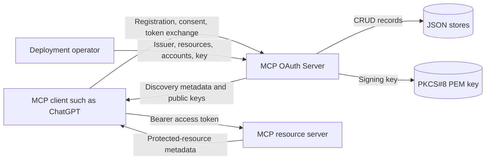
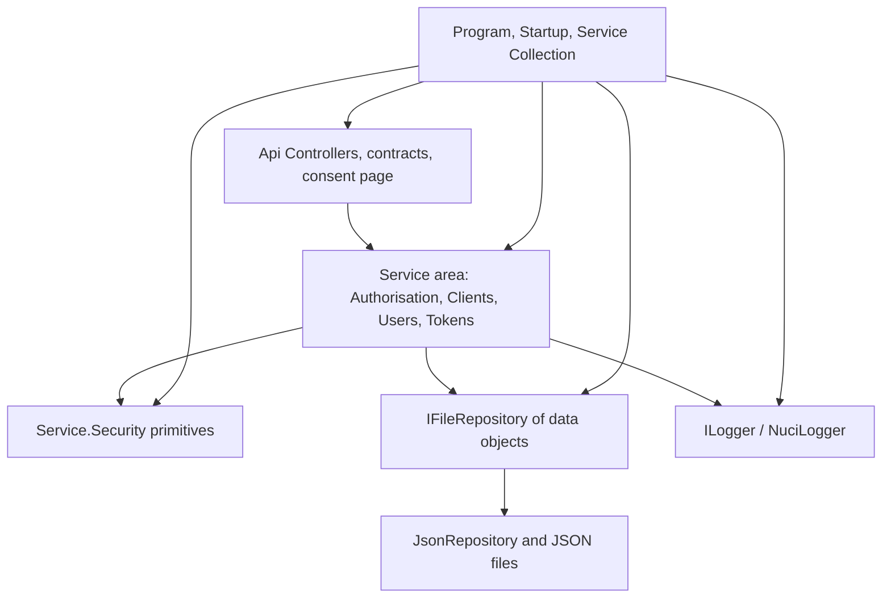
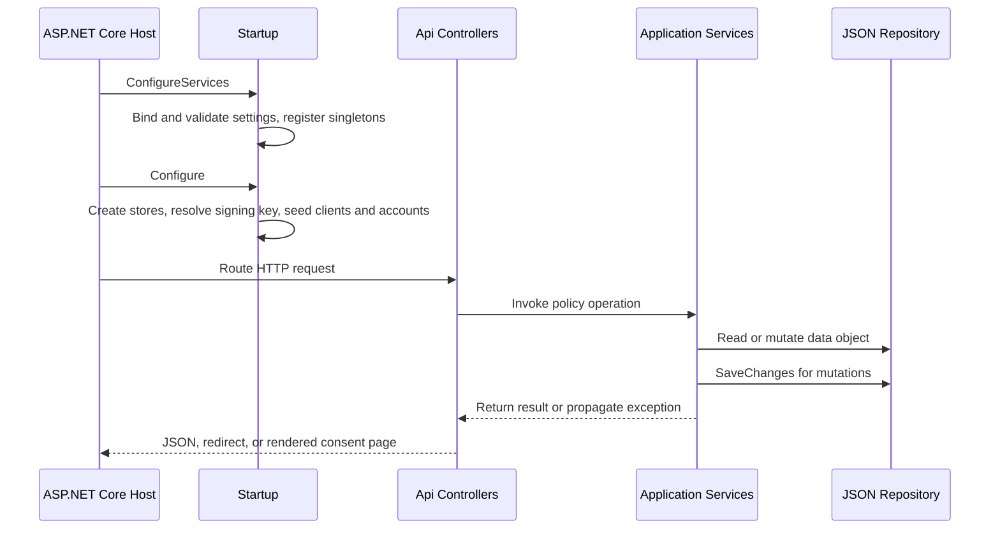
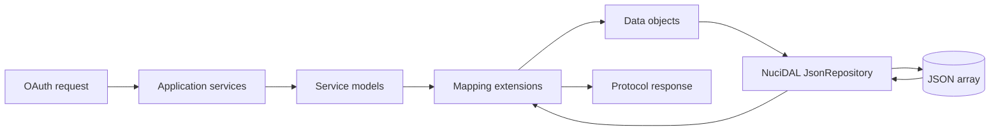
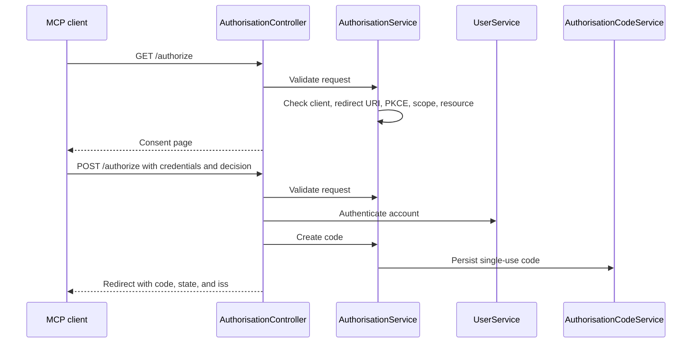
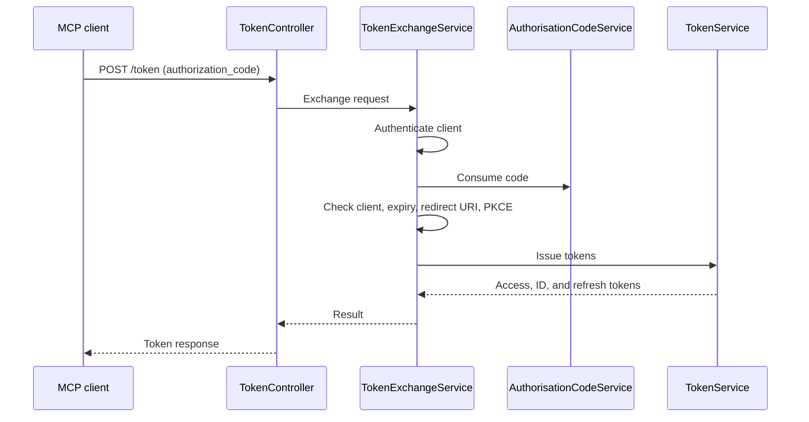
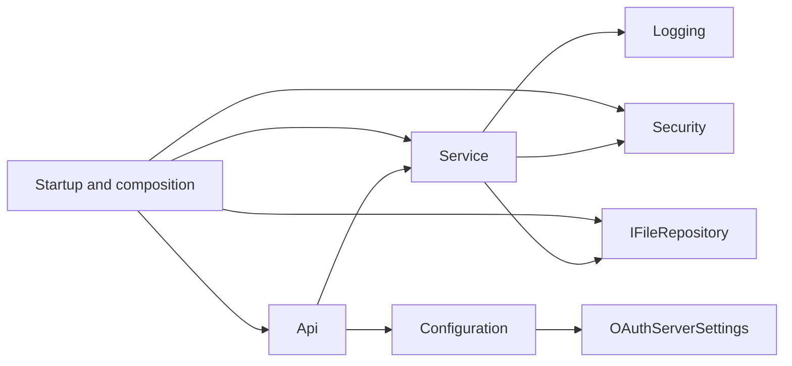

# MCP OAuth Server Architecture

This document records the verified current architecture of MCP OAuth Server: a self-hosted ASP.NET Core OAuth 2.1 authorisation server that issues tokens for Model Context Protocol resources. It covers the runtime application and the unit, integration, and architecture test projects; it does not prescribe a future architecture or deployment topology.

## 📑 Table of Contents

- [Table of Contents](#table-of-contents)
- [Purpose](#purpose)
- [System Context](#system-context)
- [Architectural Style](#architectural-style)
- [Runtime Flow](#runtime-flow)
- [Components](#components)
- [Architectural Areas](#architectural-areas)
  - [HTTP API](#http-api)
  - [Application Services](#application-services)
  - [Security Primitives](#security-primitives)
  - [Persistence and Configuration](#persistence-and-configuration)
- [Data Architecture](#data-architecture)
- [Interfaces and Integrations](#interfaces-and-integrations)
- [Key Flows](#key-flows)
  - [Authorisation Code Issuance](#authorisation-code-issuance)
  - [Token Exchange](#token-exchange)
- [Cross-Cutting Concerns](#cross-cutting-concerns)
  - [Security and Privacy](#security-and-privacy)
  - [Error Handling](#error-handling)
  - [Observability](#observability)
  - [Configuration](#configuration)
  - [Concurrency and Resource Use](#concurrency-and-resource-use)
- [Dependency Direction and Rules](#dependency-direction-and-rules)
- [External Dependencies](#external-dependencies)
- [Deployment and Operations](#deployment-and-operations)
- [Compatibility Contracts](#compatibility-contracts)
- [Testing and Verification](#testing-and-verification)
- [Design Constraints](#design-constraints)
- [Extension Points](#extension-points)
  - [Authorisation Server Components](#authorisation-server-components)
- [Architecture Decisions](#architecture-decisions)
- [Source Map](#source-map)
- [Related Documentation](#related-documentation)

## 🎯 Purpose

MCP OAuth Server supplies the authorisation-server half of the Model Context Protocol authorisation profile. It registers clients, authenticates accounts, issues and validates authorisation codes, access tokens, ID tokens, and refresh tokens, and publishes the discovery metadata that clients such as ChatGPT use to reach it. This document identifies the owning layers, persistence boundaries, and contracts that contributors must preserve when changing endpoints, policy, or cryptographic behaviour.

## 🌐 System Context

MCP clients, including the ChatGPT MCP connection, register with the authorisation server and drive an authorisation-code flow with PKCE. MCP servers act as resource servers: they advertise protected-resource metadata, redirect clients to this server, and later validate the issued access tokens against the published key set. The operator supplies the issuer identity, the signing key, and the seeded accounts.



The principal external boundaries are:
- **MCP clients:** Register, obtain consent, and exchange codes and refresh tokens; clients own redirect handling and token storage.
- **MCP resource servers:** Publish protected-resource metadata and validate issued tokens through the JSON Web Key Set; resource servers own their own audience and scope enforcement.
- **Local filesystem:** Stores grant material, client records, account records, and the signing key; the deployment environment owns durability and permissions.
- **Configuration and secret source:** Supplies the issuer, allowed resources, redirect prefixes, lifetimes, and seeded security material.

## 🏗️ Architectural Style

The application is a layered ASP.NET Core HTTP service. Controllers translate protocol contracts into application-service calls, application services enforce OAuth policy and orchestrate repositories, and NuciDAL JSON repositories own file persistence. Cryptographic primitives are isolated in a dedicated security area, and composition occurs in the host startup path, which registers each collaborator as a singleton and seeds predefined clients and accounts.



The principal architecture boundaries are:
- **HTTP API:** Depends on request and response contracts, settings, consent-page models, and application-service interfaces; it never touches repositories or cryptographic primitives directly, except that the discovery and key-set controllers read signing-key metadata.
- **Application services:** Depend on repository interfaces, the logger abstraction, security primitives, and settings; they own all OAuth policy.
- **Security primitives:** Provide hashing, PKCE verification, token generation, and signing-key material without depending on other application areas.
- **Persistence and composition:** Receive data objects through `IFileRepository`; JSON representation stays behind the repository interface.

## 🔄 Runtime Flow



The principal runtime sequence is:
1. `Program` optionally handles the `generate-password-hash` command, otherwise constructs the default ASP.NET Core host with `Startup`.
2. `Startup` binds and validates configuration, registers singleton collaborators, creates missing JSON stores, resolves the signing key, and seeds predefined clients and accounts before routing begins.
3. A controller validates the protocol contract, delegates to an application service, and renders a JSON response, an RFC 9207 redirect, or the consent page.

## 🧩 Components

| Component | Responsibility | Principal Dependencies | Lifetime or Ownership |
|-----------|----------------|------------------------|-----------------------|
| `Program` and `Startup` | Create the web host, validate configuration, create stores, seed data, and order middleware. | ASP.NET Core, configuration, DI container | Host-owned for process lifetime |
| `DiscoveryController` | Publish OAuth and OpenID Connect metadata. | `OAuthServerSettings` | Controller activation is owned by ASP.NET Core |
| `JsonWebKeySetController` | Publish the RSA public signing key. | `ITokenSigningKeyProvider` | Controller activation is owned by ASP.NET Core |
| `ClientRegistrationController` | Accept dynamic client registration. | `IClientService` | Controller activation is owned by ASP.NET Core |
| `AuthorisationController` | Validate consent requests, authenticate accounts, and issue authorisation codes. | `IAuthorisationService`, `IClientService`, `IUserService` | Controller activation is owned by ASP.NET Core |
| `TokenController` | Exchange authorisation codes and refresh tokens. | `ITokenExchangeService` | Controller activation is owned by ASP.NET Core |
| `TokenRevocationController`, `TokenIntrospectionController` | Revoke and introspect tokens. | `IClientService`, `IRefreshTokenService`, `ITokenService` | Controller activation is owned by ASP.NET Core |
| `UserInfoController` | Validate bearer tokens and return profile claims. | `ITokenSigningKeyProvider`, `IUserService` | Controller activation is owned by ASP.NET Core |
| `AuthorisationService` | Validate authorisation requests and create codes. | `IClientService`, `IAuthorisationCodeService`, settings | Singleton |
| `TokenExchangeService` | Apply grant-type policy and orchestrate token issuance. | Client, code, refresh, user, and token services | Singleton |
| `TokenService` | Sign access and ID tokens and introspect access tokens. | `ITokenSigningKeyProvider`, `IRefreshTokenService`, settings | Singleton |
| `ClientService`, `UserService` | Manage client and account records and verify secrets. | Repositories, `ISecretHasher`, settings | Singleton |
| `AuthorisationCodeService`, `RefreshTokenService` | Issue and consume single-use grant material. | Repositories | Singleton |
| `TokenSigningKeyProvider` | Create or load the RSA key and expose signing credentials. | Filesystem, settings | Singleton, disposable |
| `SecretHasher` | Hash and verify passwords and client secrets. | PBKDF2-SHA256 | Singleton |

## 🗂️ Architectural Areas

### HTTP API

Paths:
- `McpOAuthServer/Api/Controllers`
- `McpOAuthServer/Api/Requests`
- `McpOAuthServer/Api/Responses`
- `McpOAuthServer/Api/Models`
- `McpOAuthServer/Api/Mapping`

Responsibilities:
- Accept OAuth protocol routes and bind query, form, and JSON inputs.
- Render the consent page and RFC 9207 redirects.
- Map contracts to application-service models.

Boundary rules:
- Controllers invoke application-service interfaces; they do not access repositories.
- Request, response, and page models live under `Api` and never under `Service.Models`.
- `AuthorisationPageRenderer` encodes every interpolated value before emitting HTML or query parameters.

### Application Services

Paths:
- `McpOAuthServer/Service/Authorisation`
- `McpOAuthServer/Service/AuthorisationCodes`
- `McpOAuthServer/Service/Clients`
- `McpOAuthServer/Service/RefreshTokens`
- `McpOAuthServer/Service/Tokens`
- `McpOAuthServer/Service/Users`
- `McpOAuthServer/Service/Mapping`

Responsibilities:
- Own OAuth policy: response types, redirect allowlisting, PKCE, scopes, audiences, lifetimes, and grant types.
- Orchestrate repository reads and writes and emit structured operation logs.
- Map between domain models and persisted data objects.

Boundary rules:
- Services depend on `IFileRepository`, `ILogger`, and `Service.Security` abstractions, never on concrete JSON repositories or ASP.NET Core.
- Mapping exists only as internal extension methods in `.Mapping` namespaces.

### Security Primitives

Paths:
- `McpOAuthServer/Service/Security`

Responsibilities:
- Hash and verify secrets with PBKDF2-SHA256 and fixed-time comparison.
- Verify PKCE `S256` challenges.
- Generate cryptographically random codes, tokens, and client identifiers.
- Create, load, and expose the RSA signing key.

Boundary rules:
- Primitives depend only on the BCL and Microsoft.IdentityModel types.
- Raw key material never leaves the area except as signing credentials, published modulus and exponent, or a key identifier.

### Persistence and Configuration

Paths:
- `McpOAuthServer/DataAccess/DataObjects`
- `McpOAuthServer/Configuration`
- `McpOAuthServer/ServiceCollectionExtensions.cs`
- `McpOAuthServer/Startup.cs`

Responsibilities:
- Define persisted data objects and bind settings.
- Validate settings before the host starts.
- Select NuciDAL JSON repositories, security primitives, and service implementations during composition.

Boundary rules:
- Configuration classes are passive settings and validation only; they do not reference `Api` or `Service`.
- Store paths are captured at composition time and consumed when repositories are resolved.

## 💾 Data Architecture

Domain models under `Service.Models` are the in-process representation. Data objects under `DataAccess.DataObjects` are the NuciDAL persistence representation. Mapping serialises timestamps in an explicit round-trip format and converts secret material only as opaque hashes.



| Data or Store | Owner | Representation and Storage | Lifecycle or Consistency |
|---------------|-------|----------------------------|--------------------------|
| `OAuthClient` | Client service | Client identifier, name, redirect URIs, scopes, public flag, secret hash, created timestamp | Created through registration or seeding; reused until removed externally |
| `OAuthUser` | User service | Account identifier, username, password hash, email, display name, verified flag | Created through seeding; reused until removed externally |
| `AuthorisationCode` | Authorisation service | Client, user, redirect URI, scope, audience, PKCE challenge, nonce, authentication and expiry timestamps | Single-use; removed on consumption and rejected after expiry |
| `RefreshToken` | Token service | Client, user, scope, audience, nonce, expiry timestamp | Rotated on every exchange; removable through revocation |
| Signing key | `TokenSigningKeyProvider` | PKCS#8 PEM file, 2048-bit RSA | Generated when absent; reused for the lifetime of the deployment |
| Application logs | `NuciLogger` | Structured key-value events, optionally in a file | Emitted per operation |

## 🔌 Interfaces and Integrations

| Interface or Integration | Direction | Contract | Owner | Failure Semantics |
|--------------------------|-----------|----------|-------|-------------------|
| OAuth discovery | Inbound | `GET /.well-known/oauth-authorization-server` and `/.well-known/openid-configuration` | `DiscoveryController` | Always returns `200` with static metadata |
| JSON Web Key Set | Inbound | `GET /jwks` | `JsonWebKeySetController` | Always returns `200` with public parameters only |
| Dynamic client registration | Inbound | `POST /register` with JSON | `ClientRegistrationController` | Unacceptable redirect URIs return `400 invalid_redirect_uri` |
| Authorisation | Inbound | `GET` and `POST /authorize` | `AuthorisationController` | Validation failures redirect with an error when the redirect URI is valid, otherwise `400` |
| Token exchange | Inbound | `POST /token` with form data | `TokenController` | `invalid_client` returns `401`; other errors return `400` |
| Revocation and introspection | Inbound | `POST /revoke` and `POST /introspect` | `TokenRevocationController`, `TokenIntrospectionController` | Revocation always returns `200`; introspection always returns `200` with an `active` flag |
| UserInfo | Inbound | `GET /userinfo` with a bearer token | `UserInfoController` | Invalid or unusable tokens receive an authentication challenge |
| JSON persistence | Outbound | NuciDAL `JsonRepository` at the configured paths | Composition and repositories | File creation occurs at startup; later failures propagate |
| Structured logging | Outbound | NuciLog operation and status events with optional file output | Services | Logging occurs around policy operations; logger failure handling is not defined by this repository |

## 🔀 Key Flows

### Authorisation Code Issuance



The client identifier, redirect URI, PKCE challenge, scope, and resource are validated before any account is authenticated. The audience is fixed at validation time so a later token exchange cannot widen it. Consent denial redirects with `access_denied` and does not authenticate the account.

### Token Exchange



Codes and refresh tokens are consumed before validation completes, so a replayed request always fails rather than succeeding twice. Refresh exchanges are constrained to the originally granted scopes and always rotate the refresh token.

## 🧵 Cross-Cutting Concerns

### Security and Privacy

- Secrets are stored only as PBKDF2-SHA256 hashes with per-value salts and verified with fixed-time comparison.
- Authorisation codes and refresh tokens are single-use and are stored only as opaque identifiers.
- Tokens are signed with RS256; the published key set contains only modulus, exponent, and key identifier.
- The issuer must be a bare HTTPS URI, and authorisation responses always carry `iss` so clients can detect mix-up (RFC 9207).
- Redirect URIs are accepted only when they are loopback HTTP, HTTPS, and match a configured prefix.
- Client ID Metadata Documents are deliberately not implemented, avoiding outbound fetches from the registration path.
- Logs contain operation names, statuses, client and user identifiers, scopes, and audiences; they never contain passwords, secrets, tokens, or codes.

### Error Handling

- Protocol failures return OAuth error codes and human-readable descriptions; unexpected failures during authorisation propagate to the host's error page.
- Token and revocation controllers convert service results into status codes rather than leaking exceptions.
- Settings validation and signing-key resolution fail startup so a misconfigured instance never serves tokens.
- No custom exception types are defined; the BCL exceptions and result models carry failure states.

### Observability

- NuciLog emits structured events for client registration, user authentication, code creation, code exchange, refresh, revocation, and introspection.
- Every log event carries an `Operation` and structured keys rather than interpolated text.
- Microsoft.AspNetCore.Hosting emits lifecycle logs; there is no dedicated health endpoint, and the unauthenticated discovery document serves as a readiness probe.

### Configuration

| Configuration Area | Source | Responsibility | Supersede or Secret Policy |
|--------------------|--------|----------------|---------------------------|
| `OAuthServerSettings` | `appsettings.json`, environment variables, secret provider | Issuer, scopes, resources, redirect prefixes, lifetimes, seeded clients and accounts | Environment values supersede file values; seeded hashes and the key path come from the secret store |
| `DataStoreSettings` | `appsettings.json`, environment variables | JSON store locations | Relative paths resolve from the working directory |
| `NuciLoggerSettings` | `appsettings.json`, environment variables | Log destination and file output | File output can be disabled for containerised deployments |

### Concurrency and Resource Use

- All collaborators are singletons, and NuciDAL repositories serialise mutations with an internal synchronization root per repository.
- The signing key provider creates one `RSA` instance per process and is disposed by the container at shutdown.
- JSON stores are read on first use and written in full on each mutation; there is no partial update or streaming.
- The consent page and token endpoints allocate per request; no unbounded caches exist apart from the repository entity dictionaries.

## 🧭 Dependency Direction and Rules



The principal dependency rules are:
- `Api` depends on `Service` and `Configuration`, but not on `Cli` or `DataAccess`.
- `Service` depends on `Service.Security`, `NuciLog.Core`, and `NuciDAL.Repositories` interfaces, but not on `Api` or `Cli`.
- `Service` must not depend on the concrete `NuciDAL.Repositories.JsonRepository`.
- `Configuration` is a leaf area that no other production area may depend on except `Api`, `Service`, and composition.
- `DataAccess` is a leaf area consumed only by mapping and composition.
- `Logging` is a leaf area consumed only by the services that emit events.
- Production code does not declare `InternalsVisibleTo` and does not reference test assemblies.

## 📦 External Dependencies

| Dependency | Responsibility | Integration Boundary | Architectural Consequence |
|------------|----------------|----------------------|---------------------------|
| `Microsoft.AspNetCore.App` framework | Hosting, routing, MVC, HTTPS redirection | `Startup` and controllers | Controllers must stay thin and controller-based; minimal-API hosting is not used |
| `NuciDAL` | JSON persistence and repository abstractions | `AddJsonRepository`, `IFileRepository` | Store format and concurrency are dictated by the library; swapping stores replaces the repository registration |
| `NuciLog` and `NuciLog.Core` | Structured logging, operations, and log-info keys | Services and `Logging` area | Every event requires an `Operation` and structured keys |
| `Microsoft.IdentityModel.JsonWebTokens` and `Microsoft.IdentityModel.Tokens` | JWT creation and validation, base64url encoding | `TokenService`, `UserInfoController`, security primitives | Token validation semantics and supported algorithms follow the library |

## 🚀 Deployment and Operations

| Concern | Current Design | Architectural Consequence |
|---------|----------------|---------------------------|
| Process topology | One ASP.NET Core process per issuer URL | Clustering requires a shared store implementation |
| Persistent state | Four JSON stores and one PEM key on the local filesystem | The operator must provision durable, writable storage and back it up |
| Transport security | HTTPS redirection plus external TLS termination | The issuer must reflect the public origin for `iss` comparisons to succeed |
| Key management | A single RSA key generated on first start | Replacing the key invalidates previously issued tokens |
| Recoverability | Stores are plain JSON files | Backup and restore are file copies performed while writes are suspended |
| Readiness | Discovery document is unauthenticated | Operators can probe readiness without credentials |

## 🛡️ Compatibility Contracts

| Contract | Owner | Invariant | Verification | Change Policy |
|----------|-------|-----------|--------------|---------------|
| Discovery metadata field names | `DiscoveryController` | Snake-case field names and `S256` in `code_challenge_methods_supported` | `DiscoveryIntegrationTests` | Additive changes only; clients depend on exact names |
| `iss` parameter | `AuthorisationPageRenderer` and services | Every authorisation response, including errors, carries `iss` equal to the configured issuer | `AuthorisationCodeFlowIntegrationTests`, `AuthorisationErrorIntegrationTests` | Preserve byte-for-byte equality with the metadata issuer |
| Token claims | `TokenService` | `iss`, `aud`, `sub`, `client_id`, `scope`, and `at+jwt` type on access tokens | `TokenServiceTests`, `AuthorisationCodeFlowIntegrationTests` | Resource servers depend on these claims; additions are safe, removals are not |
| Error codes | Controllers and services | Documented OAuth error identifiers and status codes | `AuthorisationErrorIntegrationTests` | New codes are additive; existing codes keep their meaning and status |
| Store JSON shape | Data objects and mapping | Camel-case property names and round-trip timestamps | `McpOAuthServer.ArchitectureTests` mapping rules, unit tests | Existing records must remain readable without migration |

## ✅ Testing and Verification

Unit tests cover security helpers, settings validation, and each application service, including rejection paths for PKCE, scopes, audiences, expiry, and grant types. Integration tests host the real application with an isolated temporary data directory and exercise discovery, registration, the complete authorisation-code flow, refresh, revocation, introspection, UserInfo, and error handling. Architecture tests load the production assembly and enforce layer dependencies, boundary placement, project and solution conventions, and the repository's source conventions through Roslyn analysis.

Execute the principal automated verification with:

```bash
dotnet build --no-restore
dotnet test --no-build --verbosity normal
```

Manual verification steps for a deployed instance are recorded in the [ChatGPT Integration](docs/chatgpt-integration.md) and [Development](docs/development.md) guides. Material gaps: no test covers the reverse-proxy TLS boundary, no test measures behaviour under concurrent multi-instance deployment, and no automated test validates the live ChatGPT onboarding handshake.

## ⚠️ Design Constraints

- **Single-process state:** JSON stores are read on first use and rewritten in full, so horizontal scaling requires replacing persistence.
- **Single signing key:** No rotation mechanism or multi-key key set is implemented; key replacement invalidates issued tokens.
- **Local accounts only:** The consent page authenticates stored passwords; no federation, multifactor authentication, or session store exists.
- **No administration API:** Clients and accounts are managed through configuration or direct store edits while the service is stopped.
- **Synchronous services:** Application services are synchronous, so the token path blocks on file writes rather than awaiting them.
- **CIMD excluded:** Remote client metadata documents are not fetched, trading a registration convenience for a smaller attack surface.

## 🔧 Extension Points

### Authorisation Server Components

1. Implement or revise the owning interface under `McpOAuthServer/Service`.
2. Register the implementation in `ServiceCollectionExtensions.AddCustomServices`.
3. Add unit coverage for policy decisions and integration coverage for the affected endpoint.

Implementations must keep dependencies within the documented direction, use repository interfaces rather than concrete stores, emit an `Operation` on every log event, and preserve the error codes, claim names, and store shapes listed under Compatibility Contracts.

Replacing persistence requires only a new `IFileRepository` registration; no service depends on the concrete JSON repository. Replacing logging requires only a new `ILogger` registration.

## 📝 Architecture Decisions

| Decision | Rationale | Consequence | Record |
|----------|-----------|-------------|--------|
| Act as a self-contained authorisation server rather than delegating to a hosted provider | The project targets self-hosted MCP servers without an external identity provider | The operator owns key management, account provisioning, and availability | Documented here |
| Implement dynamic client registration but not Client ID Metadata Documents | DCR satisfies the MCP authorisation profile without fetching remote documents | No server-side request forgery through the registration path | Documented here |
| Persist grant material and accounts as JSON files through NuciDAL | Consistent with sibling projects and simple to operate | No clustering, indexing, or partial updates | Documented here |
| Always advertise and emit the `iss` parameter | RFC 9207 mix-up protection enables the stable ChatGPT redirect URI | Clients that omit `iss` validation lose that protection but still interoperate | Documented here |
| Store only hashes for passwords and confidential client secrets | Limits the impact of store disclosure | Hashes cannot be reversed; accounts must be re-seeded when a secret is lost | Documented here |
| Consume codes and refresh tokens before validating the remainder of the request | Prevents replay even when later validation fails | A failed exchange requires restarting the flow | Documented here |

## 🗺️ Source Map

| Area | Path |
|------|------|
| Composition | `McpOAuthServer/Program.cs`, `McpOAuthServer/Startup.cs`, `McpOAuthServer/ServiceCollectionExtensions.cs` |
| HTTP API | `McpOAuthServer/Api` |
| Application services | `McpOAuthServer/Service` |
| Security primitives | `McpOAuthServer/Service/Security` |
| Persistence | `McpOAuthServer/DataAccess` |
| Configuration | `McpOAuthServer/Configuration` |
| Logging identifiers | `McpOAuthServer/Logging` |
| Console commands | `McpOAuthServer/Cli` |
| Unit tests | `McpOAuthServer.UnitTests` |
| Integration tests | `McpOAuthServer.IntegrationTests` |
| Architecture tests | `McpOAuthServer.ArchitectureTests` |
| Documentation | `docs` |

## 📚 Related Documentation

- [API Reference](docs/api-reference.md) documents the endpoint contract, parameters, responses, and error codes that this architecture enforces.
- [Configuration Reference](docs/configuration.md) documents the settings bound during composition.
- [ChatGPT Integration](docs/chatgpt-integration.md) documents the external client handshake that exercises these flows.
- [Deployment Guide](docs/deployment.md) documents the operational responsibilities summarised here.
- [Testing Guide](docs/testing.md) documents the coverage summarised under Testing and Verification.
- [Security Policy](SECURITY.md) documents the vulnerability-reporting process for the boundaries described here.